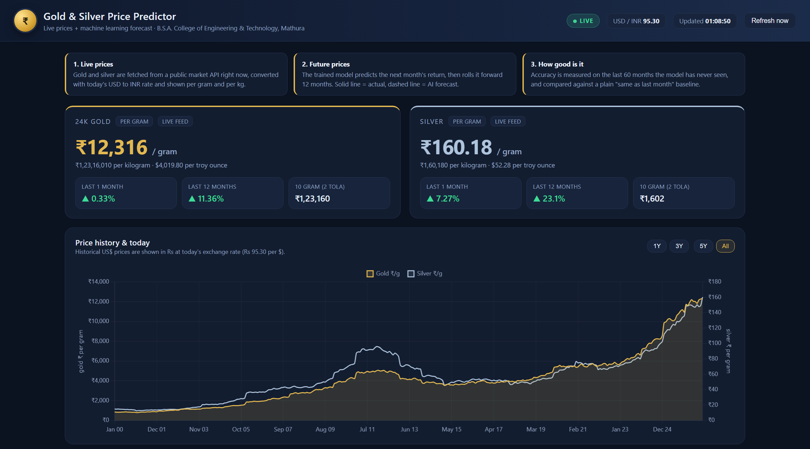
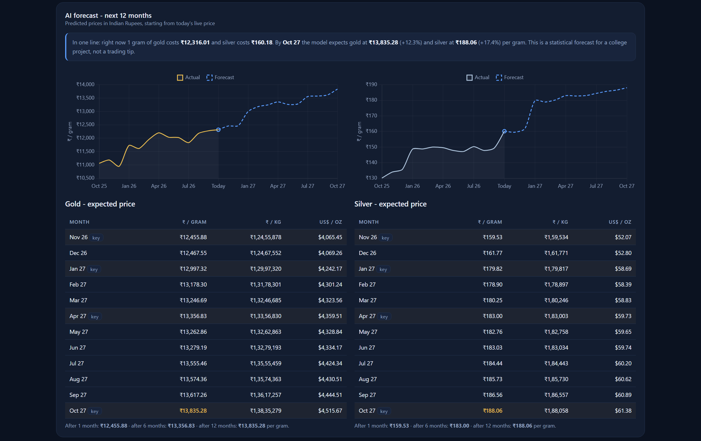
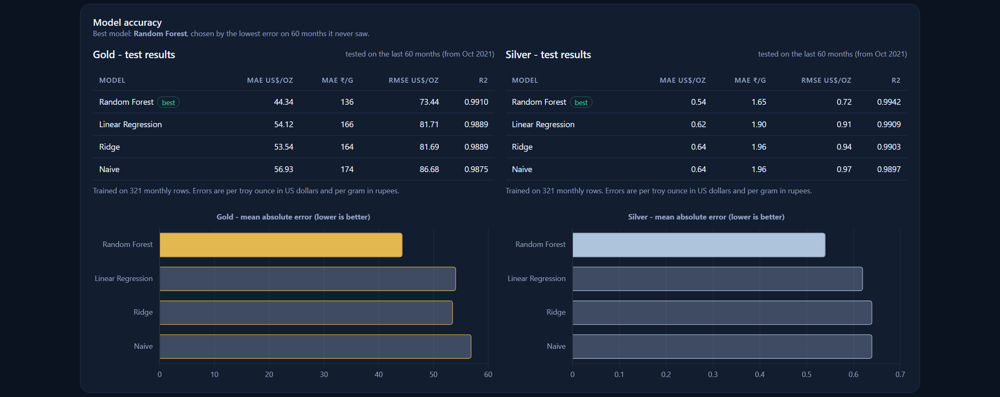

# Gold & Silver Price Predictor - Live ML Dashboard

A web dashboard that shows **today's real gold and silver price in Indian Rupees**
(fetched live from a public API) and a **12 month machine learning forecast** for
both metals, generated on your own laptop.

Built with Python, Flask, scikit-learn and Chart.js.



---

## What you see on the screen

| Panel | What it answers |
|-------|-----------------|
| **Live prices** | What does 1 gram / 1 kg / 10 gram (2 tola) cost right now, in Rs? How much has it moved in the last month and the last 12 months? |
| **Price history** | Where the price came from - monthly data from the year 2000 up to today, gold and silver on one chart |
| **AI forecast** | Where the model thinks the price is going over the next 12 months, in Rs per gram and per kg, with a month by month table |
| **Model accuracy** | How far off the model was on 60 months it had never seen, and whether it beats a plain "next month = this month" guess |

The prices refresh by themselves every 60 seconds, and **Refresh now** forces a new
call to the API. If the internet goes off, the dashboard keeps working on the last
prices it managed to fetch and says so in a red banner.

---

## Where the live data comes from

No API key and no login is needed for any of these:

| Feed | Used for |
|------|----------|
| `api.gold-api.com/price/XAU` | gold price in US$ per troy ounce |
| `api.gold-api.com/price/XAG` | silver price in US$ per troy ounce |
| `open.er-api.com/v6/latest/USD` | today's US$ to Rs exchange rate |

Market prices are quoted per troy ounce, jewellery is sold per gram, so the
dashboard converts everything:

```
Rs per gram  =  US$ per ounce  x  USD-INR rate  /  31.1035
```

Historical prices in the chart are also shown in rupees, using **today's**
exchange rate - that is stated on the chart so nobody is misled.

---

## Getting started

```bash
# 1. install the libraries
pip install -r requirements.txt

# 2. start the dashboard (trains the models automatically on the first run)
python src/dashboard.py
```

Your browser opens `http://127.0.0.1:8000` by itself. Nothing is uploaded
anywhere - the APIs are only read, and the forecasting runs locally.

To rebuild everything from scratch:

```bash
python src/make_dataset.py    # regenerates data/gold_prices.csv and data/silver_prices.csv
python src/train_model.py     # retrains both models and refreshes model/metrics.json
```

---

## Project structure

```
Gold-Price-Prediction/
├─ data/
│  ├─ gold_prices.csv        # monthly gold price in US$/oz, 2000 to last month
│  ├─ silver_prices.csv      # same for silver
│  └─ live_cache.json        # last fetched live prices (git-ignored)
├─ src/
│  ├─ make_dataset.py        # builds both csvs from public annual averages
│  ├─ live_prices.py         # calls the 3 APIs, converts to Rs, caches the result
│  ├─ price_model.py         # features + training + forecasting (shared code)
│  ├─ train_model.py         # trains gold and silver, writes model/metrics.json
│  ├─ dashboard.py           # the Flask server and the /api/summary endpoint
│  ├─ templates/dashboard.html   # the dark dashboard page (Chart.js)
│  └─ static/chart.umd.min.js    # chart library, kept locally so the page works offline
├─ model/                    # trained files land here (git-ignored)
├─ docs/                     # screenshots and the project presentation
├─ requirements.txt
└─ README.md
```

---

## How the forecasting works

The model does **not** predict the raw price. A tree model can never invent a price
higher than the biggest one it saw in training, so on a 25 year rising series it
collapses. Instead the model predicts the **month to month return**, which stays in
a small stable range, and the price is rebuilt from the last known price:

```
next_price = this_price * (1 + predicted_return)
```

- **Features**: the last 3 monthly returns, plus the month and the year.
- **Forecast**: predict one month, feed the answer back in, repeat 12 times.
- **Seed**: the last real price is the **live API price**, so the forecast always
  starts from today, not from the end of the training file.
- **Validation**: the last 60 months are held back and never used for fitting, and
  the split is chronological - no shuffling, no peeking at the future.

---

## Results

One-step-ahead accuracy on the 60 held out months (test window from Oct 2021),
error measured in US$ per troy ounce:

**Gold**

| Model | MAE | RMSE | R² |
|-------|-----|------|-----|
| **Random Forest** | **44.34** | **73.44** | 0.9910 |
| Linear Regression | 54.12 | 81.71 | 0.9889 |
| Ridge | 53.54 | 81.69 | 0.9889 |
| Naive baseline | 56.93 | 86.68 | 0.9875 |

**Silver**

| Model | MAE | RMSE | R² |
|-------|-----|------|-----|
| **Random Forest** | **0.54** | **0.72** | 0.9942 |
| Linear Regression | 0.62 | 0.91 | 0.9909 |
| Ridge | 0.64 | 0.94 | 0.9903 |
| Naive baseline | 0.64 | 0.97 | 0.9897 |

Both models beat the naive "next month = this month" guess, which is the only
comparison that matters here. R² looks very close to 1 because a 25 year trend is
easy to follow - the MAE against the baseline is the honest number.





---

## About the dataset

`data/gold_prices.csv` and `data/silver_prices.csv` are **compiled for a college
demonstration**. The yearly anchors are approximate LBMA annual averages taken from
public market data; in between, the series is interpolated and given a small AR(1)
momentum effect so short term patterns exist (see `src/make_dataset.py`). The
*current* price on the other hand is completely real - it comes from the live API.
Verify against an official feed before using any of this for anything serious.

---

## Disclaimer

Student learning project. Prices are indicative and the forecast is statistical.
**Not investment advice.**

---

**Sanchay Bhardwaj** · B.S.A. College of Engineering & Technology, Mathura ·
Computer Science & Engineering, Session 2026-27 · Project guide: **Mrs. Ashna Thakur**
