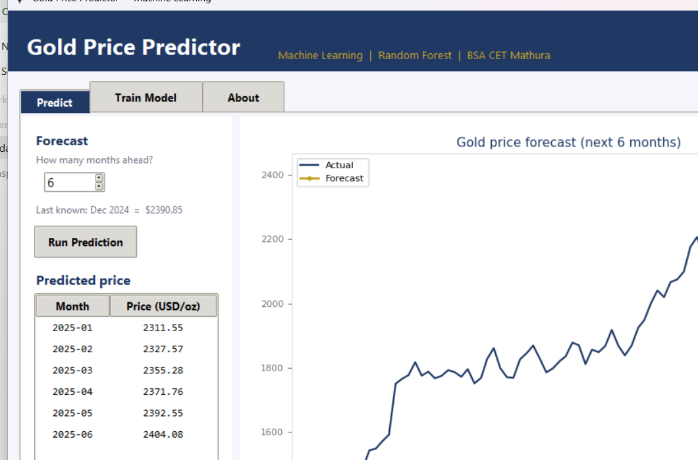
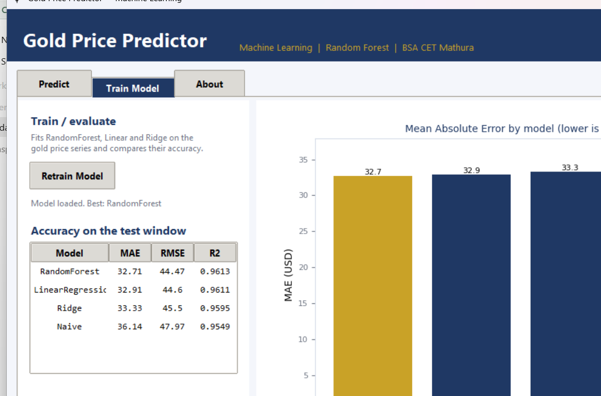

# Gold Price Predictor (Machine Learning)

A small desktop app that predicts the **monthly price of gold (USD per troy ounce)**
using its own history. Built with Python, scikit-learn and a Tkinter interface.



---

## What it does

- Trains regression models on monthly gold prices (2000 - 2024).
- Compares **RandomForest**, **Linear Regression** and **Ridge**, keeps the best one.
- Lets you pick a horizon (1 to 24 months) and forecasts the price forward.
- Shows the numbers and a chart in a simple desktop GUI.



---

## Tech stack

`Python` · `pandas` · `NumPy` · `scikit-learn` · `Matplotlib` · `Tkinter` · `Joblib`

---

## Getting started

```bash
# 1. install the libraries
pip install -r requirements.txt

# 2. train the model (saves files into model/)
python src/train_model.py

# 3. open the app
python src/app.py
```

You can retrain any time from the **Train Model** tab inside the app.

---

## Project structure

```
Gold-Price-Prediction/
├─ data/
│  └─ gold_prices.csv      # monthly gold price, 2000-2024
├─ src/
│  ├─ make_dataset.py      # builds the csv from public annual averages
│  ├─ gold_model.py        # features + train + forecast (shared code)
│  ├─ train_model.py       # trains, scores and saves the model
│  └─ app.py               # the Tkinter desktop app
├─ model/                  # trained files land here (git-ignored)
├─ docs/                   # screenshots used in this README
├─ requirements.txt
└─ README.md
```

---

## How it works

The interesting part: the model does **not** predict the raw price. A tree model can
never guess a price higher than anything it saw in training, so on a rising series it
breaks down. Instead the model predicts the **month-to-month return** (a small, stable
number), and the price is rebuilt as:

```
next_price = this_price * (1 + predicted_return)
```

Features fed to the model: the last 3 monthly returns, plus the month and year.
Forecasting is done one month at a time, feeding each answer back in as the next input.

---

## Results

One-step-ahead accuracy on the last 60 months (test window from Jan 2020):

| Model            | MAE (USD) | RMSE (USD) | R²      |
|------------------|-----------|------------|---------|
| **RandomForest** | **32.71** | **44.47**  | 0.9613  |
| LinearRegression | 32.91     | 44.60      | 0.9611  |
| Ridge            | 33.33     | 45.50      | 0.9595  |
| Naive baseline   | 36.14     | 47.97      | 0.9549  |

The models beat the naive "next month = this month" baseline, which is the point.

---

## About the dataset

`data/gold_prices.csv` is a **compiled sample** for a college demonstration. The yearly
anchors are approximate LBMA annual averages taken from public market data, then
interpolated month to month with a small momentum effect (see `make_dataset.py`).
Verify against an official feed before using it for anything serious.

---

## Disclaimer

This is a student learning project. It is **not** financial advice.

---

**B.S.A. College of Engineering & Technology, Mathura** — Computer Science & Engineering, Session 2026-27.
